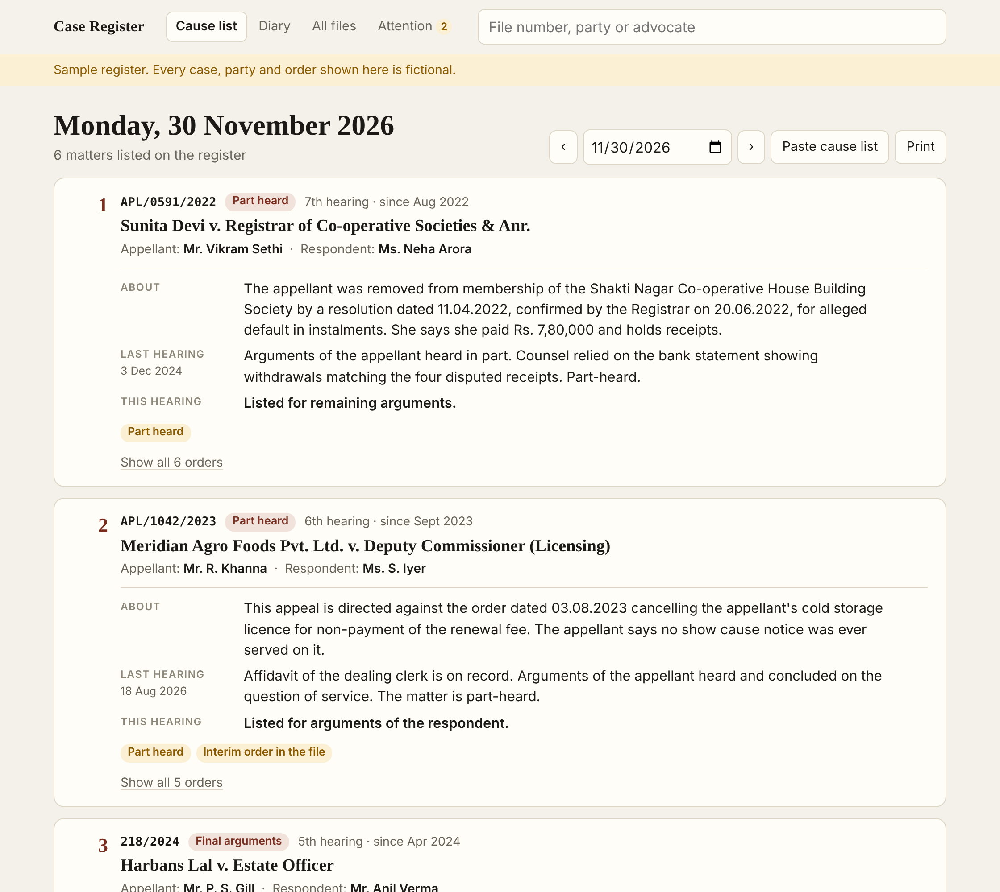

# Case Register

A file system and a reader for a bench that hears forty matters a day.

Every order that is passed gets downloaded and dropped into one folder. The register reads it, files it under its file number, notes the next date, and keeps a short brief of the case. On the day, the cause list shows each matter with that brief beside it: what the dispute is, what happened last time, what it is listed for today, and anything to watch (repeated adjournments, a last opportunity already given, costs, part heard, a party not appearing).



## Try it

```bash
python3 casefile/casefile.py serve --data casefile/sample --offline
```

Open http://localhost:8090. The sample holds 39 fictional orders in 14 files. Monday 30 November 2026 has six matters listed.

## Daily use

```bash
pip install pypdf                     # once, to read PDFs
python3 casefile/casefile.py serve    # keeps running; open http://localhost:8090
```

1. Download the day's signed orders from the court site and save them into `casefile/data/inbox/`. Any file name will do. PDF, Word (.docx), text and HTML are read.
2. Press **Check inbox** in the browser (or run `python3 casefile/casefile.py run`).
3. Open **Cause list** for the hearing date.

What the pages do:

| Page | Use |
|---|---|
| Cause list | The matters listed on a date, each with its brief. Step between hearing days, print the sheet, open any matter to see every order in it and the original file. |
| Paste cause list | Paste the official cause list for the day. The matters are put in its order, and any file on it that has no order in the register is pointed out. |
| Diary | Every future date with its count, the way the record officer's diary holds them. Also what is reserved, and what has no next date. |
| All files | The whole register. Type a file number, party or advocate in the search box to pull up that file's brief. |
| Attention | Orders that could not be placed, and matters whose hearing date has passed with no order filed since. |
| Bench note | A few lines of your own on any file, shown with its brief from then on. |

In the terminal, `python3 casefile/casefile.py list 30.11.2026` prints the same cause list.

## The folders

```
casefile/data/
  inbox/                         drop downloaded orders here
  files/APL-1042-2023/           one folder per file number
    orders/2026-08-18.pdf        each order, renamed to its date
    orders/2026-08-18.json       what was read from that order
    case.json                    the brief, the stage, the next date, the history
    note.txt                     the bench note, if any
  unfiled/                       orders with no file number that could be read
  duplicates/                    orders that were already filed
  register.json                  the index the viewer opens
```

An order can also be put straight into `files/<file no>/`; the folder then decides which file it belongs to. The same order dropped twice is recognised and set aside. `casefile/data/` is in `.gitignore`, so real orders never enter this repository or the public site.

If the court's file numbers have an unusual shape, add the pattern to `casefile/data/config.json`:

```json
{ "court": "Name of the bench", "file_no_patterns": ["Diary\\s+No\\.?\\s*([0-9]+/[0-9]{4})"] }
```

## Two ways of reading an order

**Offline (default).** Rules and pattern matching on the text of the order. Nothing leaves the computer. It finds the file number, parties, advocates, the date of the order and the next date, takes the operative lines as the summary, and raises the watch flags by counting. It works well on short daily orders, which mostly say what happened in a few lines. It cannot read a scanned PDF, and its "About" line is simply the opening of the first order.

**AI.** Claude reads each order, scanned or not, and writes the brief from the whole history of the file.

```bash
pip install anthropic
export ANTHROPIC_API_KEY=...
python3 casefile/casefile.py run --rebuild   # read everything again, once
python3 casefile/casefile.py serve
```

In this mode the content of each order is sent to the Anthropic API. The model is `claude-opus-5-5` (set `CASEFILE_MODEL` to change it), with the API's refusal fallback switched on so that an order the model declines is retried on another model. If the AI cannot read an order, it is read by rules and listed under Attention. `--offline` forces offline reading whatever keys are set.

## What has and has not been run

- Offline reading, filing, duplicates, direct drops, Word files, rebuild, the viewer on desktop and phone widths, pasted cause lists and bench notes were all run against the sample.
- The AI path was run only as far as the API's key check and against a stubbed reply. It has not yet read a real order with a real key.
- The sample orders are tidy. Real orders will throw up layouts the offline rules miss; those show under Attention, and `extract_offline` in `casefile.py` is where to teach it.

## Files

```
casefile/casefile.py           the register: read, file, brief, serve
casefile/index.html            the viewer (one file, no dependencies, works offline)
casefile/sample/               fictional orders already filed, for the demo
casefile/sample/make_sample.py regenerates the sample (needs reportlab)
```
